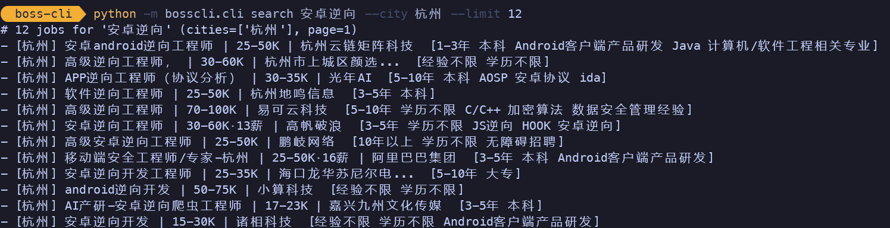
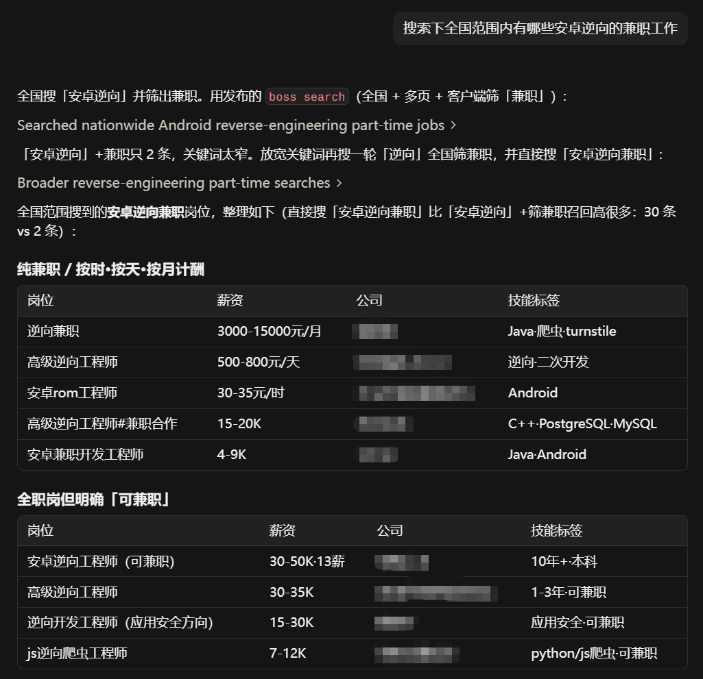

# bosscli

[](https://github.com/xaoLiu1222/bosscli/actions/workflows/ci.yml)
[](https://www.python.org/)
[](LICENSE)
[](tests)
[](#disclaimer)

**English** | [中文](#中文)

Search **BOSS直聘 (com.hpbr.bosszhipin)** jobs from your terminal or from an AI agent — off-device,
pure Python, no phone/emulator needed to run. It reproduces the app's native request signing
(`libyzwg.so`) in Python, so a plain HTTP request gets accepted by the server.



```bash
$ bosscli search "安卓逆向" --city 北京,上海,杭州
# 12 jobs for '安卓逆向' (cities=['北京', '上海', '杭州'], page=1)
- [北京] 资深Android逆向与风控对抗专家 | 70-100K·13薪 | PureblueAI
- [上海] 移动安全/逆向工程师 | 30-60K | ...
- [杭州] android逆向开发 | 50-75K | 小算科技
...
```

Or drive it from an AI agent (the MCP server) — e.g. *"find nationwide part-time Android
reverse-engineering jobs"*, rendered straight into a table (company names redacted):



## Disclaimer

> Research / educational project. It searches with **your own logged-in account's token**; you are
> responsible for complying with BOSS直聘's Terms of Service. Don't hammer the API.

## Features

- **Off-device search** — no phone, emulator, or unidbg at runtime; just Python + your session token.
- **Off-device login** — SMS-code login reproduced end-to-end (`bosscli login`), so you can mint a fresh
  `t2` yourself; the man/machine behaviour captcha (Geetest / 网易易盾) can be auto-solved (`--solve`).
- **Multi-city in one call** — `--city 北京,上海,杭州`, by name or code.
- **Server-side filters** — `--salary` / `--experience` / `--degree` / `--industry` … (or the raw
  `--filter-param KEY=VAL`); discover valid codes with `bosscli filters`.
- **Pagination** — `--pages N` or `--all` (auto-dedup across pages and cities).
- **Keyword post-filter** — `--filter 远程` / `--filter 兼职` keeps only matching jobs.
- **Text / JSON / CSV / Markdown output** — `--format` (or `--json`), write to a file with `-o`.
- **More endpoints** — `bosscli whoami` (your job expectations), `bosscli detail <securityId>` (full JD),
  `bosscli cities` (code table), `bosscli chat` (打招呼, write — dry-run by default).
- **Image upload** — `bosscli upload IMAGE`, local dry-run by default; `--confirm` uploads and returns URLs, **not a chat message**.
- **MCP server** — expose `boss_search` + `boss_filters` as tools to Claude / any MCP client.

## Install

```bash
pip install -e .                 # installs the `bosscli` command (deps include requests, lz4, Pillow)
pip install -e ".[mcp]"          # + MCP server        (python -m bosscli.mcp_server)
pip install -e ".[captcha]"      # + login captcha solvers (patchright/opencv/numpy/pycryptodome)
```

Or run without installing: `python -m bosscli.cli <cmd> ...`.

## Get your session (one-time)

The client needs three things from a **logged-in** BOSS直聘 app on a device you control:

| field | where it comes from |
|---|---|
| `t2` | the `t2` **request header** — your login token |
| `client_info` | the `client_info` query param (a JSON blob: model / uniqid / did …) |
| `uniqid` | inside `client_info` |

Capture one `GET https://api5.zhipin.com/api/batch/requests` from the app with any HTTPS
interceptor (Reqable / Charles / mitmproxy; use a frida SSL-unpin script if the app pins), then copy
those values into `session.local.json`:

```bash
cp session.example.json session.local.json    # then paste your t2 / client_info / uniqid / cardlist_defaults
```

`session.local.json` is gitignored (it holds your token). `t2` expires — when searches start returning
`invalid auth`, grab a fresh `t2` the same way.

## Usage

```bash
# by city name or code, one or several
bosscli search "Python"                              # default city from your session
bosscli search "数据分析" --city 上海
bosscli search "安卓逆向" --city 北京,上海,杭州        # multi-city, results tagged [city]

# server-side filters + pagination + cap
bosscli search "Python" --city 上海 --salary 407      # filterParams.salary code (see `bosscli filters`)
bosscli search "逆向" --city 北京 --filter-param experience=104,105   # raw filterParams passthrough
bosscli search "Golang" --pages 3 --limit 30          # fetch 3 pages, dedup, keep 30
bosscli search "算法" --all                            # fetch until exhausted (cap 10 pages)

# output
bosscli search "AIGC" --city 深圳 --format md          # text | json | csv | md
bosscli search "数据" --format csv -o jobs.csv         # write to a file
bosscli search "逆向" --city 北京,上海 --filter 远程    # client-side post-filter on title/labels/company

# discover valid filter/sort codes (industry / position / sort names)
bosscli filters "Python" --city 上海

# run without installing (module form)
python -m bosscli.cli search "AIGC" --city 深圳
```

Search options: `--city` (name/code, comma-separated) · `--pages N` / `--all` · `--sort 综合|最新|距离`
· `--limit N` · `--filter <text>` (post-filter) · `--filter-param KEY=VAL` (raw, repeatable) ·
convenience filters `--salary/--experience/--degree/--scale/--stage/--jobtype/--industry/--position`
· `--format text|json|csv|md` (`--json` shorthand) · `-o <file>` · `--token <t2>` · `--session <path>`.

City names built in: 全国 / 北京 / 上海 / 广州 / 深圳 / 杭州 / 成都 / 南京 / 武汉 / 西安 / 苏州 / 天津 / 长沙 / 重庆 / 郑州 / 厦门 (others: pass the raw code).

### Login (obtain a fresh `t2` off-device)

```bash
bosscli login --phone 15900000000 --solve            # solve man/machine captcha → send SMS → prompt code → t2
bosscli login --phone 15900000000 --send             # only send the code
bosscli login --phone 15900000000 --code 1234        # exchange an already-received code for t2
```

`login` reuses the device profile in your session file and writes the new `t2` back into it.
The man/machine step almost always demands a behaviour captcha off-device — `--solve` handles both
Geetest (via CapSolver when `CAPSOLVER_KEY` is set, else a browser harvester) and 网易易盾 (browser).
The SMS code source is pluggable with `--sms-backend manual|env|http|module:func` (see
[`bosscli/smsbackend.py`](bosscli/smsbackend.py)). See [`gt3solver/README.md`](gt3solver/README.md) for the captcha internals.

> Put `CAPSOLVER_KEY=...` (and optionally `CHAOJIYING_*` / `BOSS_SMS_*`) in a `.env` at the repo root
> and it's auto-loaded on every run — no need to re-export it. `.env` is gitignored (never committed).

### More commands

```bash
bosscli whoami                      # this account's job expectations (expectId/encryptExpectId …)
bosscli whoami --set-expect         # …and write the first one back into the session (fixes a stale expectId)
bosscli detail <securityId>         # full job detail (JD text, boss, company) for a search-result securityId
bosscli cities --grep 杭州           # BOSS city code/name table (filterable); good for finding a cityCode
# 打招呼 (WRITE): securityId/--lid/--friend-id all come from `bosscli search --json` (friend-id = the
# result's userId). DRY-RUN unless --confirm. Verified live (code 0).
bosscli search "python" --city 长沙 --json          # grab a job's securityId / lid / userId / jobId
bosscli chat <securityId> --friend-id <userId> --job-id <jobId> --lid <lid>            # dry-run preview
bosscli chat <securityId> --friend-id <userId> --job-id <jobId> --lid <lid> --confirm  # actually 打招呼
```

These reuse the exact same signing as search/login: `whoami` / `detail` / `chat` sign with the
account `secretKey` (they're not on BOSS's no-key whitelist), while `cities` is whitelisted and
signs key-less like search. `bosscli chat` is a **write** action — it messages a boss on your behalf,
so it never sends without `--confirm`.

### Image upload (not message sending)

```bash
bosscli upload ./image.png --json                 # local preview; no token or network needed
bosscli --session ./session.local.json upload ./image.png --security-id-file ./upload-security-id.txt --confirm --json
```

Only `--confirm` uploads. Requires account `secretKey`, `t2`, `client_info`, `uniqid`, and an upload-context
`securityId` (explicit option or `session.upload_defaults.securityId`, **not an arbitrary search-card ID**).
JPEG/PNG/WebP single-frame images only; default EXIF-oriented RGB JPEG conversion, or `--original` to preserve bytes.
A returned URL does **not** send an IM message or greeting. See the [image upload guide](docs/image-upload.md)
for options, local limits, and the offline/localhost validation scope; no new CLI online-upload claim is made here.

### MCP server

```bash
BOSS_SESSION=./session.local.json python -m bosscli.mcp_server
```

Register it in your MCP client (e.g. `~/.claude.json`); the tools are
`boss_search(query, city?, page?, sort?, filter_params?)` and `boss_filters(query?, city?)`.

## How it works (short version)

BOSS直聘's search goes through a batch endpoint whose params carry two anti-tamper values — `sp`
(an encrypted parameter blob) and `sig` (a signature) — both produced by the native library
`libyzwg.so`. This project reproduces that library's signing/encryption in pure Python
(`bosscli/yzwg.py`), assembles the batch request (`bosscli/signer.py`), sends it and decrypts the
reply (`bosscli/client.py`). Correctness is pinned by byte-exact tests against real captures
(`tests/`). That's the whole trick: once the signing is reproduced, the search is just an HTTP call.

```bash
python tests/test_yzwg.py       # native crypto — byte-exact vs real-device captures
python tests/test_signer.py     # request assembly round-trip
```

## Layout

```
bosscli/yzwg.py     signing / encryption primitives (pure Python)
bosscli/signer.py   request assembly (batch + plain branches)
bosscli/client.py   search + read/write endpoints (whoami/detail/cities/chat/upload) + signed-call core
bosscli/login.py    off-device SMS-code login (man/machine → smsCode → codeLogin → t2)
bosscli/smsbackend.py  pluggable SMS-code source for login (manual / env / http / custom)
bosscli/localenv.py    loads a gitignored .env (CAPSOLVER_KEY / CHAOJIYING_* / BOSS_SMS_*) at startup
bosscli/output.py   text / json / csv / markdown rendering
bosscli/cli.py      the `bosscli {search,filters,whoami,detail,cities,chat,upload,login}` CLI
bosscli/mcp_server.py  MCP wrapper (tools: boss_search, boss_filters)
gt3solver/          login captcha solvers (Geetest GT3 + 网易易盾) — see its README
tests/              byte-exact regression tests + fixtures
session.example.json   template for your session
```

---

# 中文

[English](#bosscli) | **中文**

在终端或 AI agent 里搜 **BOSS直聘（com.hpbr.bosszhipin）** 职位 —— 纯 Python、离设备，跑的时候不需要手机/模拟器。
它把 App 的 native 请求加签库（`libyzwg.so`）用 Python 复现了出来，所以一条普通 HTTP 请求就能被服务器接受。


```bash
$ bosscli search "安卓逆向" --city 北京,上海,杭州
# 12 jobs for '安卓逆向' (cities=['北京', '上海', '杭州'], page=1)
- [北京] 资深Android逆向与风控对抗专家 | 70-100K·13薪 | PureblueAI
- [杭州] android逆向开发 | 50-75K | 小算科技
...
```

也可以让 AI agent 通过 MCP 来驱动 —— 比如「搜一下全国的安卓逆向兼职」，结果直接渲染成表格（公司名已打码）：


> 研究 / 学习用途。它用的是**你自己登录账号的 token** 去搜；请自行遵守 BOSS直聘的服务条款，别高频打接口。

## 功能

- **离设备搜索** —— 运行时不需要手机 / 模拟器 / unidbg，只要 Python + 你的 session token。
- **离设备登录** —— 短信验证码登录全链路复现（`bosscli login`），可自己拿新 `t2`；man/machine 行为
  验证码（Geetest / 网易易盾）可 `--solve` 自动求解。
- **一条命令多城市** —— `--city 北京,上海,杭州`，支持城市名或城市码。
- **服务端过滤器** —— `--salary` / `--experience` / `--degree` / `--industry` …（或原样透传
  `--filter-param KEY=VAL`）；用 `bosscli filters` 查可用码表。
- **翻页** —— `--pages N` 或 `--all`（跨页跨城自动去重）。
- **关键词后筛** —— `--filter 远程` / `--filter 兼职`，只保留标题/标签/公司命中的岗位。
- **文本 / JSON / CSV / Markdown 输出** —— `--format`（或 `--json`），`-o` 落盘。
- **更多接口** —— `bosscli whoami`（你的求职期望）、`bosscli detail <securityId>`（完整 JD）、
  `bosscli cities`（城市码表）、`bosscli chat`（打招呼，写操作，默认 dry-run）。
- **图片上传** —— `bosscli upload IMAGE` 默认纯本地预览；`--confirm` 才上传并返回地址，**不发送聊天消息**。
- **MCP 服务** —— 把 `boss_search` + `boss_filters` 暴露成工具给 Claude / 任意 MCP 客户端。

## 安装

```bash
pip install -e .                 # 装上 `bosscli` 命令（依赖包括 requests、lz4、Pillow）
pip install -e ".[mcp]"          # + MCP 服务       （python -m bosscli.mcp_server）
pip install -e ".[captcha]"      # + 登录验证码求解器（patchright/opencv/numpy/pycryptodome）
```

也可不安装直接跑：`python -m bosscli.cli <命令> ...`。

## 获取 session

客户端需要从一台**已登录** BOSS直聘的设备上拿三个凭证：

| 字段 | 来源 |
|---|---|
| `t2` | 请求头里的 `t2` —— 你的登录 token |
| `client_info` | query 参数 `client_info`（一段 JSON：机型 / uniqid / did …） |
| `uniqid` | 在 `client_info` 里面 |

用任意 HTTPS 抓包工具
抓一条 App 发出的 `GET https://api5.zhipin.com/api/batch/requests`，把上面几个值填进 `session.local.json`：

```bash
cp session.example.json session.local.json    # 再把你的 t2 / client_info / uniqid / cardlist_defaults 粘进去
```

`t2` 会过期 —— 搜索开始返回 `invalid auth` 时，照上面再抓一个新的即可。

## 用法

```bash
# 按城市名或城市码，单个或多个
bosscli search "Python"                              # 用 session 里的默认城市
bosscli search "数据分析" --city 上海
bosscli search "安卓逆向" --city 北京,上海,杭州        # 多城市，结果带 [城市] 标签

# 服务端过滤器 + 翻页 + 限量
bosscli search "Python" --city 上海 --salary 407      # filterParams.salary 码（见 `bosscli filters`）
bosscli search "逆向" --city 北京 --filter-param experience=104,105   # 原样透传 filterParams
bosscli search "Golang" --pages 3 --limit 30          # 抓 3 页、去重、留 30 条
bosscli search "算法" --all                            # 抓到没有为止（最多 10 页）

# 输出
bosscli search "AIGC" --city 深圳 --format md          # text | json | csv | md
bosscli search "数据" --format csv -o jobs.csv         # 写到文件
bosscli search "逆向" --city 北京,上海 --filter 远程    # 客户端后筛（标题/标签/公司）

# 查可用的过滤/排序码表（行业 / 职位 / 排序名）
bosscli filters "Python" --city 上海

# 不安装、直接模块方式跑
python -m bosscli.cli search "AIGC" --city 深圳
```

搜索参数：`--city`（名/码，逗号分隔）· `--pages N` / `--all` · `--sort 综合|最新|距离` · `--limit N`
· `--filter <文本>`（后筛）· `--filter-param KEY=VAL`（原样，可重复）· 便捷过滤
`--salary/--experience/--degree/--scale/--stage/--jobtype/--industry/--position` ·
`--format text|json|csv|md`（`--json` 简写）· `-o <文件>` · `--token <t2>` · `--session <路径>`。

内置城市名：全国 / 北京 / 上海 / 广州 / 深圳 / 杭州 / 成都 / 南京 / 武汉 / 西安 / 苏州 / 天津 / 长沙 / 重庆 / 郑州 / 厦门（其它城市直接传城市码）。

### 登录（离设备拿新 `t2`）

```bash
bosscli login --phone 15900000000 --solve            # 解 man/machine 验证码 → 发短信 → 输入验证码 → t2
bosscli login --phone 15900000000 --send             # 只发验证码
bosscli login --phone 15900000000 --code 1234        # 用已收到的验证码换 t2
```

`login` 复用 session 里的设备档，把新 `t2` 写回 session。离设备时 man/machine 几乎必弹行为验证码：
`--solve` 同时支持 Geetest（配了 `CAPSOLVER_KEY` 走 CapSolver，否则走浏览器 harvester）和网易易盾（浏览器）。
短信验证码来源可插拔：`--sms-backend manual|env|http|module:func`（见
[`bosscli/smsbackend.py`](bosscli/smsbackend.py)）。验证码原理见 [`gt3solver/README.md`](gt3solver/README.md)。

> 把 `CAPSOLVER_KEY=...`（以及可选的 `CHAOJIYING_*` / `BOSS_SMS_*`）写进仓库根目录的 `.env`，
> 每次运行自动加载，不用再 export。`.env` 已在 `.gitignore` 里（绝不进库）。

### 更多命令

```bash
bosscli whoami                      # 当前账号的求职期望（expectId/encryptExpectId …）
bosscli whoami --set-expect         # …并把第一个写回 session（修掉过期/换号后残留的 expectId）
bosscli detail <securityId>         # 某岗位完整详情（JD 全文 / boss / 公司），securityId 来自搜索结果
bosscli cities --grep 杭州           # BOSS 城市码/名表（可筛），用来查 cityCode
# 打招呼（写操作）：securityId/--lid/--friend-id 都来自 `bosscli search --json`（friend-id = 结果里的 userId）。
# 不加 --confirm 只 dry-run。已实盘验证（code 0）。
bosscli search "python" --city 长沙 --json          # 拿到某岗位的 securityId / lid / userId / jobId
bosscli chat <securityId> --friend-id <userId> --job-id <jobId> --lid <lid>            # dry-run 预览
bosscli chat <securityId> --friend-id <userId> --job-id <jobId> --lid <lid> --confirm  # 真正打招呼
```

这些接口复用与 search/login 完全相同的加签：`whoami` / `detail` / `chat` 不在 BOSS 的免 key 白名单上，
用账号 `secretKey` 加签；`cities` 在白名单里，和 search 一样免 key。`bosscli chat` 是**写**操作
（以你名义给 boss 发消息），因此不加 `--confirm` 绝不发送。

### 图片上传（不是发消息）

```bash
bosscli upload ./image.png --json                  # 无 token 也可本地预览，不访问网络
bosscli --session ./session.local.json upload ./image.png --security-id-file ./upload-security-id.txt --confirm --json
bosscli --session ./session.local.json upload ./image.png --original --confirm  # 已在 session 配上传 securityId 时
```

- 只有 `--confirm` 才上传。需要账号 `secretKey`、`t2`、`client_info`、`uniqid` 等；`--token` 可覆盖 `t2`。
- 上传 `securityId` 用 `--security-id TOKEN` 或 `--security-id-file PATH`（互斥），否则读
  `session.upload_defaults.securityId`；**不要任意拿搜索卡片的 `securityId` 替代**。
- 默认做 MD5 预检，`--skip-precheck` 可跳过；仅 JPEG/PNG/WebP 单帧，默认 EXIF 转正、白底 RGB JPEG，
  `--original` 保留原字节。20 MiB / 40M 像素是本地保护，不是服务端阈值。
- `--json` 含 `code` / `message` / `zpData` 及本地 `_upload` 元数据。**返回 URL 不表示对方收到图片**，不会发 IM 消息或打招呼。

详见[图片上传文档](docs/image-upload.md)及[协议纠正记录](docs/upload-capture.md)。协议来自 2026-11-11 历史捕获，
验证含签名离线重算、mock 和 localhost HTTP 测试；后续在用户明确选岗与发图授权后，已完成一次真实上传和聊天消息回执验收，不会自动重复发送。

### 搜索 → 选择岗位 → 打招呼并发图（纯 Python）

```powershell
python -m bosscli.cli --session session.local.json outreach "安卓安全" --city 北京 --image .\portfolio.png
```

在交互终端中先列岗位，输入一个编号，再核对公司、招聘者、岗位/用户 ID 和图片，输入一次 `yes` 才执行。
运行时不需要手机或 ADB；需要有效登录态及本地 `session.im` TLS 配置。已在用户明确选择并确认的单个岗位上，
**实测打招呼、图片上传和对应消息的业务回执均成功**。回执证明服务器接收，不代表招聘者已读；非公开协议未来可能变化。

- 搜索 token 只用于打招呼；上传/发图用打招呼响应自动取得的对应会话 token，不让用户混填。
- 预置 `--confirm` 时必须钉住 `--expected-job-id` 与 `--expected-user-id`，防止重搜排序或招聘者变化导致误发。
- 发送记录防止重复打招呼和盲目重发；超时不等于没送到，不能删除记录后直接重跑。
- 只支持人工选中的单岗位，不群发。使用说明及验证边界见[完整沟通流程](docs/outreach.md)。

### MCP 服务

```bash
BOSS_SESSION=./session.local.json python -m bosscli.mcp_server
```

在 MCP 客户端里注册（如 `~/.claude.json`）；工具名 `boss_search(query, city?, page?, sort?, filter_params?)`
和 `boss_filters(query?, city?)`。

## 原理

BOSS直聘的搜索走一个批量端点，参数里带两个防篡改值 —— `sp`（加密参数串）和 `sig`（签名），都由 native 库
`libyzwg.so` 生成。本项目把这个库的加签/加密**用纯 Python 复现**（`bosscli/yzwg.py`），装配批量请求
（`bosscli/signer.py`）、发出去再解密响应（`bosscli/client.py`）。正确性靠对真实抓包的字节级测试兜底
（`tests/`）。核心就这一点：加签一旦复现出来，搜索就只是一次普通 HTTP 请求。

## 免责声明

仅供安全研究与学习交流。请勿用于任何违反 BOSS直聘服务条款或相关法律法规的用途；因使用本项目产生的一切后果由使用者自负。
